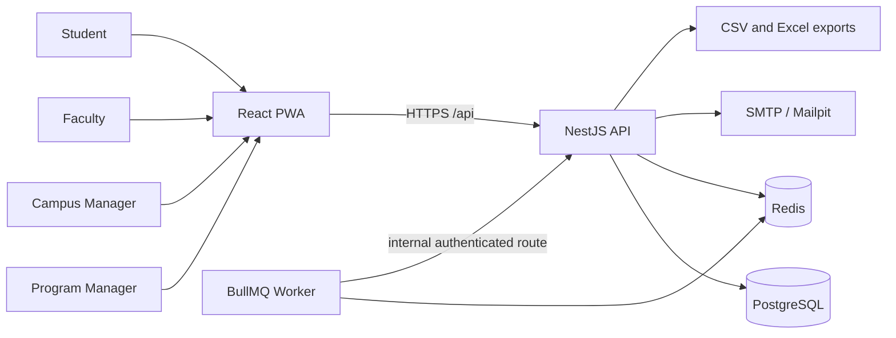
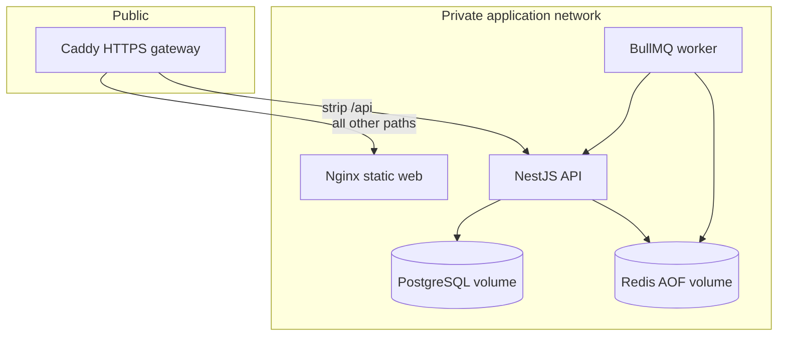

# Architecture

## System context

Mirai Tracker is a responsive course-progression system for Program Managers, Campus Managers, Faculty and Students. PostgreSQL is the academic source of truth. Redis holds short-lived sessions and background-job state. A worker sends reminders and escalations. The browser communicates only with the NestJS API.

## Application containers

Only Caddy exposes host ports. API and worker run as an unprivileged user. The API applies committed Prisma migrations before accepting traffic. Readiness checks require PostgreSQL and Redis.

## Internal modules

| Layer               | Responsibility                                                                |
| ------------------- | ----------------------------------------------------------------------------- |
| React PWA           | Role-aware navigation, responsive forms, dashboards, student view and exports |
| NestJS controllers  | HTTP contracts, Zod request validation and role declarations                  |
| Domain services     | Access scopes, atomic workflows, audit events and report generation           |
| Shared calculations | Minute-based progress, coverage, buffer, pace, roll-ups and exam readiness    |
| Prisma/PostgreSQL   | Relationships, uniqueness, migrations, transactions and durable history       |
| Redis/BullMQ        | Opaque sessions, login throttling and scheduled missed-log scans              |
| SMTP                | Faculty reminders and 48-hour Campus Manager escalation                       |

## Core data flow

1. Managers configure campuses, semesters, calendar rules, exams, batches and offerings.
2. Timetable patterns generate dated sessions after applying holidays and working-Saturday rules.
3. A lesson plan supplies ordered units, topics, planned minutes and exam mappings.
4. The scheduling engine allocates topic minutes to dated sessions and versions the result.
5. Faculty confirm or correct daily delivery; each revision updates topic progress atomically and writes an audit event.
6. Shared functions calculate subject progress. Track and campus summaries retain the worst subject status.
7. Students receive a read-only view derived from their authenticated batch.

## Trust boundaries

- The public boundary ends at Caddy and the API.
- Browser mutations must carry the configured exact origin.
- Authentication and role guards are global; services repeat campus, offering and batch checks.
- Worker-to-API calls use a separate internal secret.
- Academic records are durable in PostgreSQL; Redis can be recreated at the cost of sessions and queued work.
