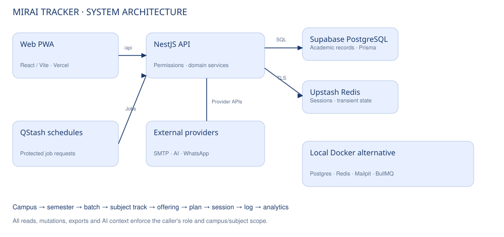

# Architecture diagram

[Separate SVG](architecture.svg) · [Editable Mermaid](architecture.mmd) · [Design document](design-document.md)

The system architecture distinguishes the live Vercel/Supabase/Upstash deployment from the local Docker/BullMQ environment. The live API uses Supabase PostgreSQL; local Docker supplies PostgreSQL for development and disposable tests. External providers require their configured credentials.
