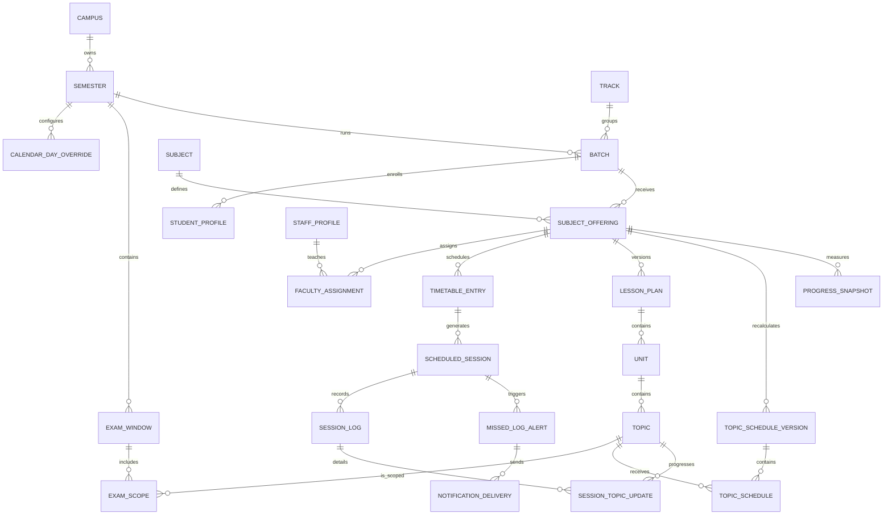

# M02 Database and Domain Model

M02 turns the college problem statement into a PostgreSQL model. The schema is designed around auditable teaching progress: a topic has a planned duration, each scheduled class can have a revisioned log, and every progress change can be traced back to a session and user.

## Core design decisions

1. `Subject` is the reusable catalogue definition. `SubjectOffering` is that subject taught to one batch in one semester. Timetables, faculty, lesson plans and progress attach to the offering.
2. All teaching durations are stored as integer minutes. This avoids rounding differences from decimal hours. The application can display hours when needed.
3. Lesson plans are versioned. Units and topics belong to one version, so an approved plan remains reproducible after a later upload.
4. Topic schedules are also versioned. Calendar, timetable, cancellation and lesson-plan changes create a new calculated schedule instead of overwriting old evidence.
5. Session logs are revisioned and contain per-topic before/after percentages. This supports partial coverage, carry-forward work, corrections and an audit trail.
6. Progress snapshots store the inputs and result of each calculation. Reports can explain why an offering was on track, tight or in danger on a given date.
7. Users and their roles are separate. Global roles use the `GLOBAL` scope; campus roles require a campus scope. A PostgreSQL check constraint enforces this rule.
8. Deletes are restrictive for master and historical data. Child rows that only make sense with their parent, such as topics within a lesson plan, cascade with the parent.

## Relationship overview

## Model groups

| Area | Models | Purpose |
| --- | --- | --- |
| Identity and access | `User`, `RoleAssignment`, `StaffProfile`, `StudentProfile` | People, global/campus roles, regular or visiting faculty, student enrollment |
| Academic setup | `Campus`, `Track`, `Semester`, `Batch`, `Subject`, `SubjectOffering` | Campus-specific semester delivery without duplicating subject definitions |
| Calendar and exams | `CalendarDayOverride`, `ExamWindow`, `ExamScope` | Holidays, events, extra working days, exam windows and topic-level syllabus deadlines |
| Faculty and time | `FacultyAssignment`, `TimetableEntry`, `ScheduledSession` | Faculty allocation, recurring timetable slots and concrete dated classes |
| Lesson plan | `LessonPlan`, `Unit`, `Topic` | Versioned syllabus hierarchy, planned minutes and current completion |
| Recalculation | `TopicScheduleVersion`, `TopicSchedule`, `ProgressSnapshot` | Explainable schedule history and course-health calculations |
| Daily evidence | `SessionLog`, `SessionTopicUpdate` | Completion status, covered/left-over work, classwork/homework and per-topic progress |
| Alerts | `MissedLogAlert`, `NotificationDelivery` | Deduplicated faculty reminders, manager escalation and channel delivery history |
| Bulk operations | `ImportJob`, `ImportError`, `ExportJob` | Upload validation, row-level errors and downloadable reports |
| Audit | `AuditEvent` | Actor, entity, before/after JSON and timestamp for sensitive changes |

## Problem-statement traceability

| Requirement | Database support |
| --- | --- |
| Multiple campuses, batches and semesters | Campus → semester → batch hierarchy with unique campus/semester and semester/batch keys |
| Academic calendar, second/fourth Saturdays, events and holidays | `workingSaturdayRule` plus dated `CalendarDayOverride` records |
| Timetable and actual class dates | Recurring `TimetableEntry` rows generate traceable `ScheduledSession` rows |
| Lesson plan with units, topics and allotted hours | Versioned lesson plans; topic duration stored in `plannedMinutes` |
| Faculty log after every class | Revisioned `SessionLog` tied to a scheduled session and logger |
| Completed, in progress, skipped, merged and cancelled | Matching enums on sessions and logs |
| Covered, left over and next-class carry forward | Log summaries and `carryForwardTopicId`; detailed changes in `SessionTopicUpdate` |
| Classwork and homework | Separate `WorkStatus` fields in every session log |
| Exam-wise syllabus completion | `ExamWindow` and topic-level `ExamScope` with `syllabusDeadline` |
| Dynamic planned dates | Versioned topic schedule with a calculation reason |
| Hour-weighted progress and early warning | Decimal `ProgressSnapshot` inputs, coverage, buffer, pace and status |
| Faculty reminder and manager escalation | Deduplicated `MissedLogAlert` and retryable `NotificationDelivery` |
| CSV/Excel import with validation feedback | `ImportJob` and row-level `ImportError` |
| Data export and visiting-faculty report | Typed `ExportJob`, including honorarium export |
| Change history | Generic `AuditEvent` with before/after values and actor |

## Database safeguards

The initial SQL migration adds checks for valid semester, exam, assignment and timetable ranges; weekdays 1–7; end times after start times; positive topic and allocated minutes; ordered thresholds; versions and revisions greater than zero; percentages from 0 through 100; nonnegative progress inputs; consistent import counts; and valid role scope.

Prisma provides foreign keys, required fields, uniqueness and indexes. The raw PostgreSQL checks cover rules Prisma cannot describe. The schema contract tests ensure the required models, enums and safeguards remain present if the migration is regenerated later.

## Fictional seed

`apps/api/prisma/seed.ts` is idempotent and only creates local demonstration data: HI-Tech campus, Mirai track, Sample Semester 2026, one sample batch, a Data Structures and Algorithms offering, local program-manager/faculty users and a two-topic draft lesson plan. The `.local` addresses are placeholders and do not create external accounts or send email.

## Verification levels

- `pnpm check` validates TypeScript, schema contracts, application tests and production builds without a running database.
- `prisma validate` validates Prisma syntax and relations when `DATABASE_URL` is set.
- `pnpm db:test` runs constraint tests against a migrated PostgreSQL instance.
- `docker compose up --build` applies the committed migration before starting the API; this final runtime check requires Docker.
