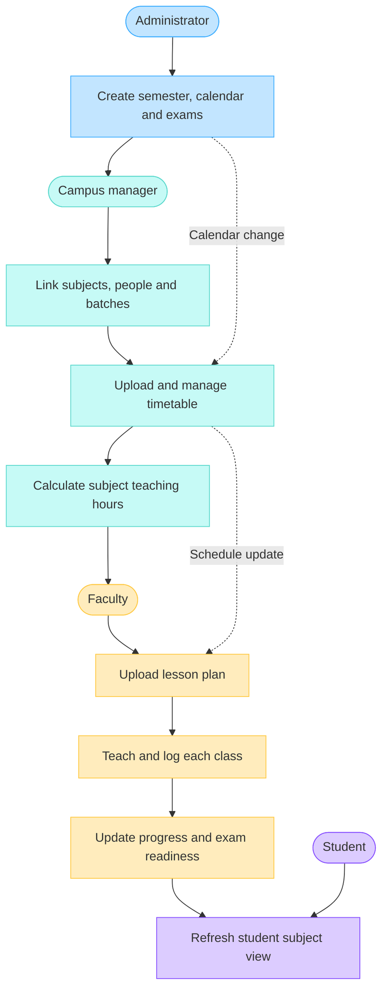
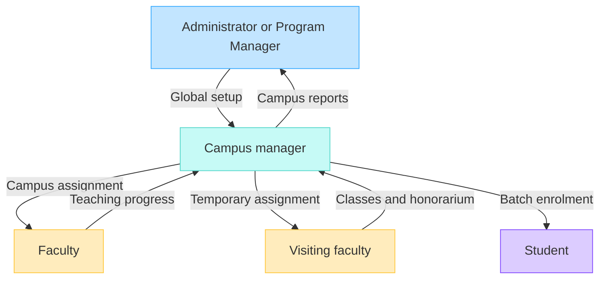
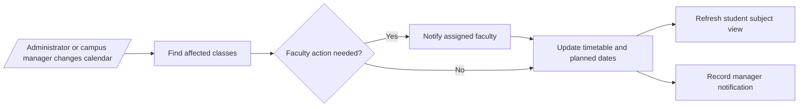

# Mirai Tracker Role Workflows and Access

This guide shows how academic information moves from semester setup to classroom delivery, and what each person can do. Access is always limited by role and scope: administrators work globally, campus managers work within assigned campuses, faculty work within assigned subjects, and students see their enrolled batch.

## End-to-end academic flow

The critical path is: administrator defines the semester, campus manager creates the delivery schedule, faculty plans and records teaching, and students receive a read-only view of the result. A calendar change flows down through the timetable and faculty plan before appearing in the student view.

## Access hierarchy

Visiting faculty is an assignment type rather than a separate system role. Once a visiting teacher receives faculty access and a subject assignment, they follow the faculty workflow. The campus manager additionally tracks classes delivered and the configured per-class honorarium.

## What each role can do

| Person                          | Scope                         | Main actions                                                                                                                                                                                              | Information available                                                                                                                                     |
| ------------------------------- | ----------------------------- | --------------------------------------------------------------------------------------------------------------------------------------------------------------------------------------------------------- | --------------------------------------------------------------------------------------------------------------------------------------------------------- |
| Administrator / Program Manager | All campuses                  | Create semesters, import and manually edit calendars, manage exam windows, create subjects, manage users and campus managers, review notifications, reports and exports                                   | Cross-campus progress, teaching delivery, faculty activity, exam readiness, audit information and AI summaries                                            |
| Campus Manager                  | Assigned campus               | Create and link subjects, assign teachers, add Faculty and Student access, upload and edit the complete timetable, add extra classes, maintain campus calendar changes, and manage visiting-faculty rates | Campus subjects, timetable, faculty activity, lecture delivery, progress, exam readiness, notifications, reports and honorarium totals                    |
| Faculty                         | Assigned subjects only        | Upload a partial or full lesson plan, manage planned dates, record daily lecture delivery, optionally log through WhatsApp, and respond to schedule changes                                               | Assigned hours, upcoming classes, covered and pending topics, subject progress, exam readiness, notifications, AI insights and their own teaching reports |
| Visiting Faculty                | Assigned subjects and classes | Uses the Faculty flow after assignment; records the classes actually delivered                                                                                                                            | Assigned hours, class schedule, subject plan and personal class count; payment is calculated per approved class                                           |
| Student                         | Enrolled campus and batch     | No academic editing                                                                                                                                                                                       | Read-only subject list, teachers, covered topics, upcoming topics and exam dates or syllabus                                                              |

## Change and notification flow

Every update remains inside the role hierarchy. Faculty receive changes for their assigned subjects, campus managers receive campus-level activity, administrators receive global or escalated activity, and students receive only the resulting read-only academic information.

## Permission principles

- The API enforces the same scope shown by the interface; hiding a button is not the security boundary.
- Campus managers cannot manage another campus.
- Faculty cannot view or edit another faculty member's subject unless separately assigned.
- Students cannot edit calendars, timetables, lesson plans, lecture logs, progress or user access.
- Changes to teaching history retain the responsible user and time for review.
